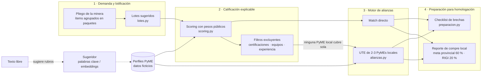

# Arquitectura

## Flujo

La diferencia con el diagrama original de la propuesta: la columna 4 se llama **Preparación
para homologación** y no "Pre-homologación", porque el desafío pone como límite que la
solución **no reemplaza los procesos de homologación**.

## Capas

| Capa | Ubicación | Responsabilidad | Depende de |
|---|---|---|---|
| Motor de dominio | `backend/app/core` | Toda la lógica. Python puro + pydantic. | nada externo |
| Servicio | `backend/app/api/servicio.py` | Une repositorio y motor; cachea análisis | core |
| API | `backend/app/api/rutas.py` | HTTP/JSON, validación, códigos de error | servicio |
| Frontend | `frontend/src` | Presentación. No calcula nada del dominio | API |

El motor no sabe que existe una web: se puede testear solo (`pytest`), reutilizar en un
script o exponer por otra vía.

## Algoritmos (para defender en la oral)

**Lotificación (`lotes.py`).** Para cada ítem de cada paquete:
- si algún requisito excluyente no lo tiene ninguna PyME local → se separa del paquete;
- si el volumen supera la capacidad de la PyME local más grande → se divide en
  `k = ceil(volumen / p75)` lotes, donde `p75` es el percentil 75 de las capacidades locales
  (máximo 6 lotes);
- el resto del paquete queda junto.

**Scoring (`scoring.py`).** `puntaje = Σ peso_i × cumplimiento_i × 100`, con 6 criterios
(cobertura de rubros 35 %, capacidad 20 %, certificaciones 20 %, maquinaria 10 %,
experiencia 10 %, dotación 5 %). Cobertura y capacidad se ponderan por el monto de cada
rubro en el lote. *Apto* = cumple **todos** los excluyentes. Desempate: apto → puntaje →
local → id.

**UTEs (`alianzas.py`).** Es una variante del **problema de cobertura de conjuntos**
(*set cover*): los elementos son los requisitos del lote y cada PyME cubre un subconjunto.
En general es NP-difícil, pero con 12 candidatos y grupos de 2 o 3 hay 286 combinaciones:
se prueban todas (solución óptima dentro de los candidatos). Cada grupo se evalúa como un
**perfil combinado** con el mismo scoring, y se descartan socios redundantes (los que al
quitarlos no bajan el puntaje).

**Capacidad compartida (`analisis.py`).** Los lotes se recorren en orden; la capacidad
asignada a uno se descuenta para los siguientes (asignación *greedy*). Una mejora posible
es la asignación global óptima (issue en el backlog).

## Simplificaciones conocidas

Están documentadas a propósito: son parte del *know-why* del equipo.

1. En una UTE, una certificación se considera cubierta si la tiene **al menos un** socio.
   En la realidad, algunas (p. ej. seguridad e higiene) se exigen a todos. El checklist
   marca a cada socio que no la tiene.
2. Las capacidades de un mismo rubro se **suman** entre socios.
3. La condición de "proveedor local" se estima con datos declarados; la verifica el Repromin.
4. La asignación de capacidad entre lotes es *greedy*, no óptima.
5. Los datos viven en memoria (se pierden al reiniciar). Ver ADR 0003.
